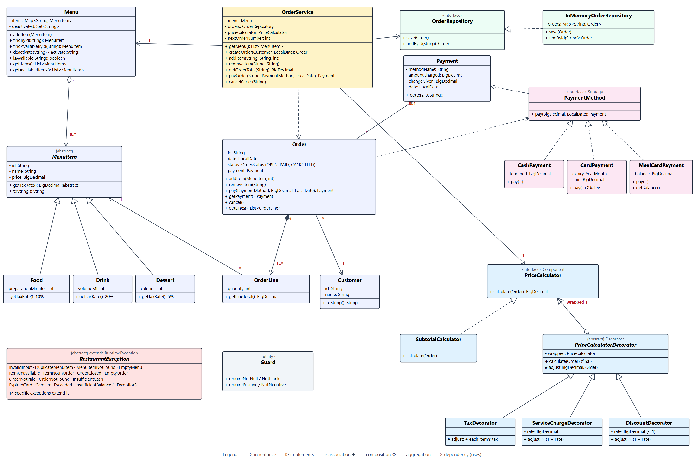

# Restaurant Ordering

Java classes and JUnit 5 tests for the orders of a small restaurant. There is no running program. The tests are the only way the code runs.

## Run the tests

In Eclipse, choose File > Import > Maven > Existing Maven Projects, then right-click the project and choose Run As > JUnit Test.

With Maven:

```
mvn test
```

## Packages

| Package | Contents |
| --- | --- |
| `restaurant.menu` | Menu and its items: food, drinks and desserts |
| `restaurant.customer` | The customer who places an order |
| `restaurant.order` | Orders, their lines and where they are stored |
| `restaurant.payment` | Cash, card and meal card payments (Strategy) |
| `restaurant.pricing` | Subtotal, tax, service charge and discount (Decorator) |
| `restaurant.service` | The restaurant operations |
| `restaurant.exception` | One base exception and the specific ones |
| `restaurant.common` | Shared input checks |

## Design



| Idea | Where |
| --- | --- |
| Strategy | `PaymentMethod` with `CashPayment`, `CardPayment` and `MealCardPayment`; `Order.pay` uses whichever one it is given |
| Decorator | `PriceCalculator` with `SubtotalCalculator`; `TaxDecorator`, `ServiceChargeDecorator` and `DiscountDecorator` wrap another calculator |
| Dependency injection | `OrderService` gets its `OrderRepository` and `PriceCalculator` through the constructor, so tests can pass fakes |
| Exceptions | Every project exception extends the unchecked `RestaurantException` |

## Rules used

| Rule | Value |
| --- | --- |
| Tax on food | 10% |
| Tax on drinks | 20% |
| Tax on desserts | 5% |
| Discount | A percentage below 100% taken off the amount calculated so far |
| Cash | The amount handed over must cover the amount due, and the difference is given back |
| Card | A 2% fee is added, the card must not be expired, and the charge must fit the card limit |
| Meal card | The card balance must cover the amount due, and the amount is taken from the balance |
